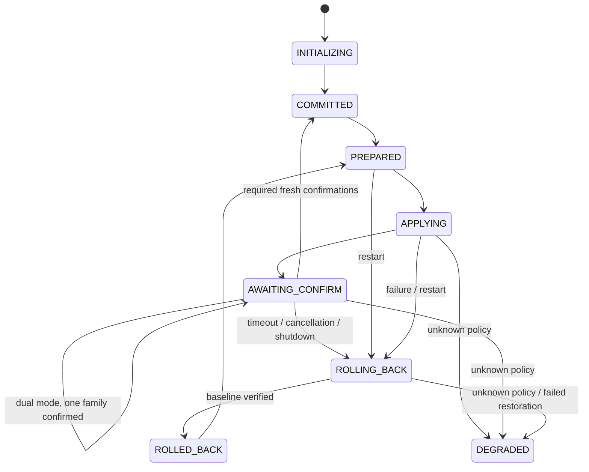

# Architecture and failure model

## Components

The CLI uses the same TLS request implementation exercised in real-network tests. The HTTP service calls `Controller`, the production state machine shared by portable tests and Linux fault tests. `NftBackend` checks, applies and reads actual kernel policy. There is no test-only second state machine.

SQLite uses WAL and FULL synchronous mode. Each state transition and operation-history update commits before dependent side effects. Checkpointing happens after that commit and is maintenance, not the commit decision: a failed/busy checkpoint produces a status warning and cannot turn a committed confirmation back into a pending one. Normal later checkpointing clears the transient warning. Events and operation receipts retain at most 64 rows each. The state directory has a 4 MiB admission budget and requires 8 MiB free space before accepting a change; these are admission checks, not a filesystem quota. A 256 KiB reserve is released before rollback, and an independent rescue record holds the known policy context. ENOSPC is not guaranteed recoverable: restoration is attempted even if journal updates fail, and failed persistence blocks new changes.

Before recovery can retire a process or touch kernel rules, the stored snapshot is checked for bounded size (64 KiB), JSON shape, policies, generation/operation identifiers, finite clocks and phase-specific requirements. Provisioning is recognized by the exact initialization shape, not merely the operation ID: `initial` remains a legal normal transaction ID. Before commitment, persisted `current` and `baseline` must agree; an inconsistent pair is rejected before backend access. Unusable data produces an in-memory DEGRADED diagnostic; the original snapshot remains preserved. This does not reconstruct an untrusted journal or authorize guessing a baseline.

`agent.lock` excludes a second live controller. `writer.lock` is held around writes and inherited across executor birth and its same-PID `exec(nft)`. Recovery reads at most 4 KiB of executor identity data and validates its token, required fields and types before any process lookup or signal. A malformed record produces DEGRADED without a speculative kill or kernel write. Recovery verifies executor token, PID, start ticks and boot ID, signals through pidfd, waits for exit, then acquires ownership. ESRCH during pidfd open/signaling means the identified process naturally exited; recovery continues to the writer-lock and kernel checks. Other permission/syscall failures still fail closed. If an executor-intent record exists but its identity record does not, recovery can proceed only when the inherited writer lock is demonstrably free. Otherwise it fails closed.

## State machine

Recovery conservatively rolls back unfinished changes; it does not resume their confirmation window. A durable COMMITTED survives a lost HTTP response. A readback must equal the canonical expected policy compiled independently from the submitted schema. Only nft handle/metainfo fields are omitted; policy, expression order and unknown fields remain significant.

Confirmation decisions are serialized with mutations, check CLOCK_BOOTTIME before and after readback, and bind generation, operation, digest and random challenge. TCP acceptance is timestamped before TLS. A post-apply `/proc/net/tcp` snapshot additionally rejects preexisting peers that were queued in the listening socket backlog. For legacy mode this is IPv4-only; dual mode additionally snapshots tcp6. It is intentionally conservative: some legitimate connections opened during application can be rejected and must reconnect.

## Transport and admission

The service permits at most 16 accepted connections with 2-second inactivity timeouts, a 5-second absolute accepted-connection lifetime, and a 16 KiB request-body cap. TLS, headers, bodies and keepalive share that absolute lifetime; trickling bytes cannot renew it. History is read under the decision lock but network output occurs after releasing it. Kernel calls/executors have 2-second bounds. Application is serialized; there is no unbounded application job queue. HTTP overload closes excess connections. Confirmation windows are 1–300 seconds. TLS and an externally provisioned shared bearer credential identify a trusted operator, without per-user roles.

## Recovery guarantees and exclusions

The tests cover process death, orphan fencing, kernel/journal boundaries, deadline decisions, old TCP connections, lost confirmation responses and observed external drift. The separate deployment suite verifies actual systemd and orderly boot of one isolated Linux VM with a disposable namespace. It does not establish disk-controller durability under power loss, fail-closed early boot, arbitrary hosts’ boot ordering, arbitrary privileged concurrency or safety across heterogeneous nft versions. A stopped agent cannot execute a timer; service-manager restart is an availability dependency. Unknown policy is retained for operator inspection.

## New-boot restoration

A changed kernel boot ID allows one additional recovery action: recreation of an absent owned table. While holding `writer.lock`, the controller persists `boot_restore_intent` with the old boot ID before kernel creation. For terminal states it reinstalls `current`; for unfinished states it installs `baseline` and completes rollback. Readback, updated boot identity and an advanced generation are required before normal operation. A process exit after creation but before completion can be retried from the durable prior state and verified kernel policy. Same-boot table deletion and unknown existing policy are not silently repaired.

The deployment fixture installs the production wheel and exact service unit, checks installed module bytes, and confines the unit to a namespace using a drop-in. Only the held-executor scenario overrides the production fault-hook-clearing setting; all other scenarios use the normal environment. systemd’s control-group cleanup and the production identity/writer-lock recovery path provide complementary fencing. No old process can survive a VM boot; stale operation requests are separately tested after a newer commit.

## Startup dependency failures

Systemd restart throttling and controller reconciliation solve different problems. The unit retries failed exits with a one-second delay and limits starts to five within sixty seconds. If a prerequisite keeps failing before controller startup, the service can remain failed with the pending candidate still installed. Local cause repair and an explicit reset/start allow the existing reconciliation path to restore the baseline. Rate limiting bounds retry pressure; it does not supply a second rollback executor or guarantee availability.

The actual-service fault uses a missing TLS key, while malformed snapshot handling is a separate test. Neither proves recovery from a native parser crash, hung storage syscall or power loss. A separate rescue daemon would also need trusted policy, fencing and failure-domain design; no such independent recovery path is claimed here.

## Management preflight and external ownership

The optional startup configuration declares bounded named IPv4 TCP destination ports at the local input hook. The production Controller evaluates first-match candidate rules for NEW traffic before admitting a new change. A blocked declared port causes a 409 without writing intent or applying policy. Plan and newly admitted apply expose diagnostics; responses do not alter journal schema. Idempotent receipt lookup is labeled separately. Startup recovery/rollback remain governed by their existing known-policy rules.

A bounded read-only `nft -j -s list ruleset` snapshot supplies foreign-chain diagnostics in the same namespace. A small conservative model distinguishes supported input conflicts, uncertainty and unavailable evidence. Other hooks/objects and truncation are explicit; no external rule is changed and no external ownership lock is claimed. Own-policy denial gates apply; foreign results are warnings. New-connection confirmation remains the actual post-apply check. See [scope, budgets and deployment](MANAGEMENT_PREFLIGHT.md).

## Opt-in dual-stack transaction

[Dual mode](DUAL_STACK.md) owns paired ip/ip6 tables in one nft batch, with one journal/generation/deadline and separate durable family confirmations. Its IPv6-only socket excludes mapped IPv4, and confirmation uses the actual transport family. Partial confirmation remains AWAITING_CONFIRM; timeout/restart restores the entire baseline. Existing IPv4 installs are not automatically migrated. Full IPv6 preflight remains unimplemented; ICMPv6 is accepted explicitly in this TCP-focused slice. The old IPv4 architecture sections describe legacy mode.
