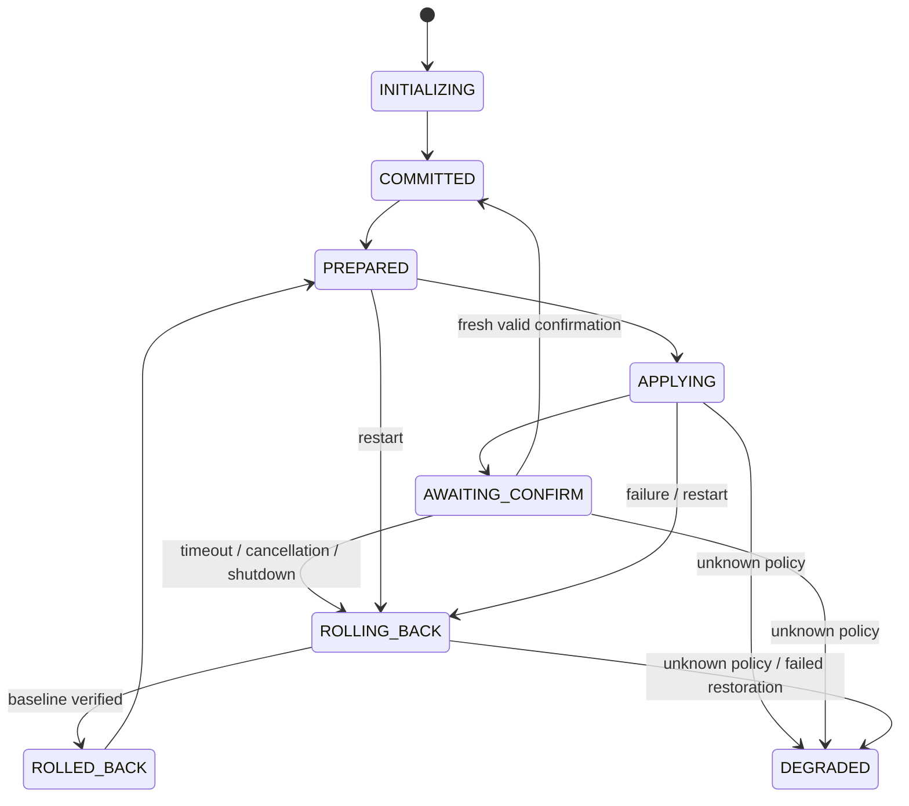

# Architecture and failure model

## Components

The CLI uses the same TLS request implementation exercised in real-network tests. The HTTP service calls `Controller`, the production state machine shared by portable tests and Linux fault tests. `NftBackend` checks, applies and reads actual kernel policy. There is no test-only second state machine.

SQLite uses WAL and FULL synchronous mode. Each state transition and operation-history update commits before dependent side effects. Events and operation receipts retain at most 64 rows each. The state directory has a 4 MiB admission budget and requires 8 MiB free space before accepting a change; these are admission checks, not a filesystem quota. A 256 KiB reserve is released before rollback, and an independent rescue record holds the known policy context. ENOSPC is not guaranteed recoverable: restoration is attempted even if journal updates fail, and failed persistence blocks new changes.

`agent.lock` excludes a second live controller. `writer.lock` is held around writes and inherited across executor birth and its same-PID `exec(nft)`. Recovery verifies executor token, PID, start ticks and boot ID, signals through pidfd, waits for exit, then acquires ownership. If an executor-intent record exists but its identity record does not, recovery can proceed only when the inherited writer lock is demonstrably free. Otherwise it fails closed.

## State machine

Recovery conservatively rolls back unfinished changes; it does not resume their confirmation window. A durable COMMITTED survives a lost HTTP response. A readback must equal the canonical expected policy compiled independently from the submitted schema. Only nft handle/metainfo fields are omitted; policy, expression order and unknown fields remain significant.

Confirmation decisions are serialized with mutations, check CLOCK_BOOTTIME before and after readback, and bind generation, operation, digest and random challenge. TCP acceptance is timestamped before TLS. A post-apply `/proc/net/tcp` snapshot additionally rejects preexisting peers that were queued in the listening socket backlog. This is IPv4-only and intentionally conservative: some legitimate connections opened during application can be rejected and must reconnect.

## Transport and admission

The service permits at most 16 accepted connections with 2-second socket timeouts and a 16 KiB request-body cap. Kernel calls/executors have 2-second bounds. Application is serialized; there is no unbounded application job queue. HTTP overload closes excess connections. Confirmation windows are 1–300 seconds. TLS and an externally provisioned shared bearer credential identify a trusted operator, without per-user roles.

## Recovery guarantees and exclusions

The tests cover process death, orphan fencing, kernel/journal boundaries, deadline decisions, old TCP connections, lost confirmation responses and observed external drift. They do not establish disk-controller durability under power loss, entire-host boot ordering, arbitrary privileged concurrency or safety across heterogeneous nft versions. A stopped agent cannot execute a timer; service-manager restart is an availability dependency. Unknown policy is retained for operator inspection.
