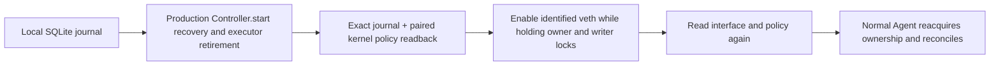
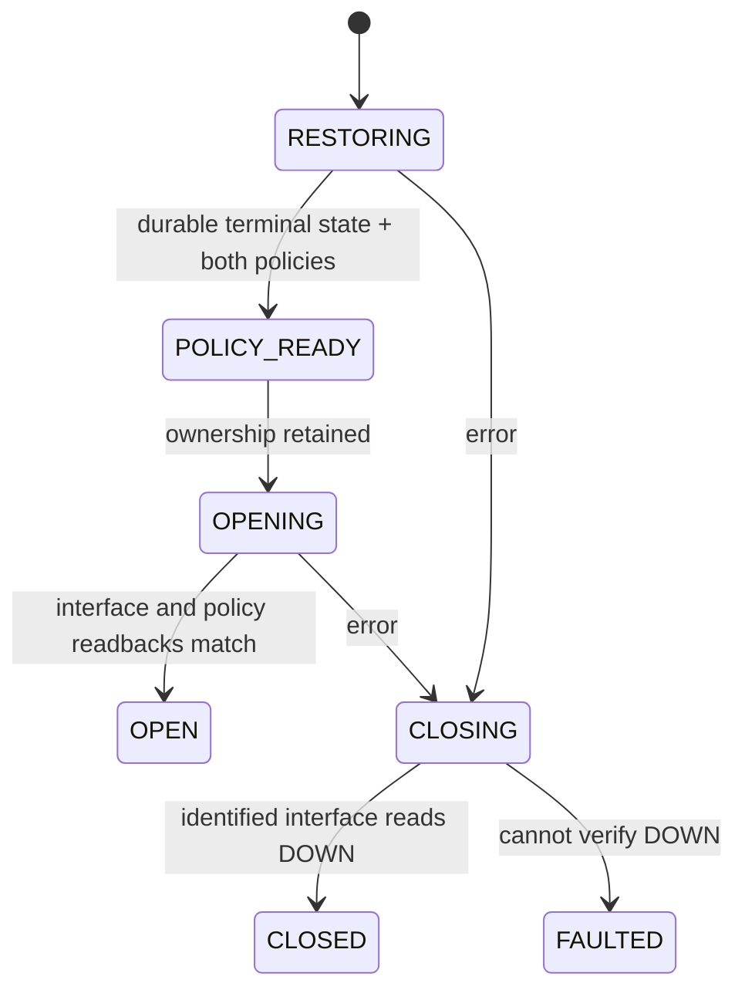

# Boot Guard MVP: early recovery before a controlled interface opens

Boot Guard is an **opt-in installed entry point**, `rulemoor-boot-guard`, and a
systemd oneshot service. It runs the existing production `Controller.start()`
before enabling a separately managed interface. It has no TLS, token, DNS or
remote-filesystem dependency. The default Agent service remains unchanged unless
the supplied opt-in dependency drop-in is installed.

This first version deliberately supports only one named Linux network namespace
with a static **veth** interface identified by name, MAC and one explicit address
per family. It refuses the root
network namespace and other link types. The operator must reserve activation of
this interface to Rulemoor; this is an explicit deployment precondition, not an
automatic inventory or exclusion of every privileged network manager. It is not
a general physical-NIC/network-manager installer.

## Production flow



The gate holds `guard.lock` for open/close serialization, `agent.lock` through
recovery/open completion, and `writer.lock` across final validation, UP, and final
readbacks. Only profile-owned static addresses are added while DOWN; foreign global
addresses cause refusal. Linux can remove static IPv6 addresses when an interface
goes DOWN, so reopening explicitly restores them and checks both families again
before and after UP. It issues no address flush/delete command; Linux DOWN itself can discard IPv6
addresses. Unknown global addresses require local operator handling. This MVP uses nodad for
the configured IPv6 address in the exclusive static veth profile; it does not
qualify duplicate-address handling on a shared/physical network.

The Agent then reacquires ownership and reconciles again. This is
checked release/reacquisition, not an atomic process-to-process lock transfer.
Receipts are observations, never permission to open. Every open uses live state.

`Controller.start()` returning DEGRADED or reporting failed persistence is a
failure, not readiness. Pending/partially confirmed changes restore the full
baseline. Committed state restores current policy after a genuine new boot.
Unknown rules or a corrupt journal are not silently repaired. Preflight admission
checks do not replace or obstruct the existing restoration decisions.



Systemd `ExecStopPost` also closes the interface after process/startup failure.
Startup and stop have explicit timeouts; cgroup cleanup precedes the stop helper.
Receipt writes are not prerequisites for DOWN: CLOSING/CLOSED write errors still
fail the service, but cannot skip the identified interface's close attempt. If
receipt storage fails, an old OPEN receipt can remain; inspect the actual unit
and link, never treat cached status as readiness. A failed DOWN preserves its
original error even if recording FAULTED also fails. This does not guarantee
cleanup when the kernel, interface commands or required configuration cannot execute it.
A normal Agent restart does not restart the active gate or flap the interface.
An explicit gate stop stops its dependent Agent and closes the controlled link;
it does not flush firewall rules or change foreign tables.

## Restricted service and host namespace identity

The main/stop processes keep only CAP_NET_ADMIN and CAP_KILL. Integration first
found that direct access to `/proc/1/ns/net` was denied with this reduced set;
a read-only nsfs bind also failed during systemd mount setup. These failed runs
were not counted as passing validation.

The chosen implementation uses an explicit **root ExecStartPre setup step**
(systemd's `+` prefix) to read PID 1's namespace identity and atomically write a
private, bounded, boot-bound JSON anchor under its RuntimeDirectory. This short
setup process bypasses the main service's capability/sandbox restrictions; it is
a deliberate trusted-root setup dependency, not a claim that every process in
the unit runs with only two capabilities. It does not load policy or activate a
link. The restricted main/stop processes verify anchor ownership, mode, size and
boot identity, then reject the root namespace. No long-running CAP_SYS_PTRACE or
CAP_SYS_ADMIN permission is added to them. Outside this unit, the root CLI can
inspect PID 1 directly.

The main unit clears the executor fault-hook environment variable, protects
system/home paths, and permits writes only to state/runtime directories. The VM
fixtures add a namespace dependency/override and memory accounting; the installed
base unit bytes are compared to the shipped template. No isolation from arbitrary
root processes is claimed.

## Opt-in deployment contract

Runtime requirements: Linux/systemd, Python 3.12+, nftables and iproute2 (`ip`),
with local state/configuration and an independently reachable management path.

1. Build/install the project wheel into `/opt/rulemoor/venv`. The wheel contains
   the production gate entry point; source-controlled unit templates live in
   `deploy/`. Provision the existing dual-stack journal using normal Agent init.
2. Supply a local boot dependency which creates the named namespace and the
   intended static veth **DOWN**, with stable MAC and both addresses/routes. No
   other tool may automatically activate this link. Keep independent console or
   management access outside this namespace.
3. Install the private, root-owned (0600, no symlink, max 4 KiB) profile at
   `/etc/rulemoor/boot-guard.json`:

   ```json
   {"version":1,"interface":"rg0","mac":"02:00:00:77:00:02","namespace":"/run/netns/rulemoor-guard","activation_owner":"rulemoor-exclusive","ipv4":"192.0.2.42/24","ipv6":"2001:db8:88::2/64"}
   ```

4. Install `deploy/rulemoor-boot-guard.service`. Its default namespace path is
   `/run/netns/rulemoor-guard`; any override must match the profile and require
   the local topology service with explicit ordering. Do not use a skipped
   Condition as evidence of readiness. Run systemd unit verification and inspect
   dependency cycles before enabling it.
5. Install `deploy/rulemoor-agent-guard.conf` as an Agent drop-in. Run the Agent
   in the **same namespace**, with the same state directory and dual-stack mode.
   Its TLS/configuration still follows normal provisioning rules. The gate has
   Before=network-pre.target for ordering, but that target alone cannot enforce
   a mandatory host-wide failure gate.
6. Observe the actual unit result, current namespace/interface, journal and
   paired kernel rules. `/var/lib/rulemoor/boot-guard.json` alone is not readiness.
   Invalid/missing configuration or an unavailable interface can prevent even the
   cleanup helper from running: treat an old receipt as stale and use console
   inspection, not a cached OPEN status.

The fixture below is the reproducible supported reference deployment. These
steps describe its contract, not a universal one-command host firewall installer.
Do not adapt it to the VM/host's primary management interface without independent
recovery access and a separate integration review.

## Fault and data-plane verification

The new runner builds the production wheel, verifies installed module hashes and
unit-template hashes, and exercises it under real systemd in an isolated Colima
Linux VM. It tests:

* **Actual recovery write failure:** a real pending transaction is created by the
  installed Controller. A temporary PATH wrapper delegates nft reads unchanged
  but makes the production executor's real write invoke nft with an invalid
  option. The unchanged Guard/Controller/Backend path becomes DEGRADED, returns
  failure and leaves the link DOWN; candidate policy remains for local inspection.
  Removing the fault and explicitly repairing the private fixture's journal then
  allows restoration. This is command/write rejection, not disk I/O or kernel-hang
  emulation, and automatic repair of an untrusted journal is not implemented.
* **Agent unavailable/delayed:** removing the TLS key prevents Agent startup while
  the gate still restores/enables successfully. An actual Agent start delay and
  restart are checked independently of policy/link readiness.
* **Crashes during activation:** temporary ip subprocess wrappers hold the real
  Guard call immediately before or after actual UP. Killing its actual MainPID
  with SIGKILL must retire the wrapper through cgroup cleanup and run the formal
  ExecStopPost close helper. Same invocation, signal status 9 and same-interface
  DOWN readbacks are retained. The post-UP window exists; it is not zero exposure.
* **Delayed executor:** the existing production executor hook pauses a real old
  writer before nft exec. Its controller is killed without killing the orphan;
  the gate retires that identified process before admitting a distinct successor.
  Releasing its old marker after retirement cannot overwrite the successor during
  the finite observation. It does not prove a live obsolete writer resumed safely
  or cover every possible kernel interruption.
* **Receipt write failure:** after actual UP, an ip wrapper replaces only the
  receipt destination with a directory. The unchanged atomic JSON replacement
  fails with EISDIR; both open-error cleanup and formal ExecStopPost still issue
  DOWN. A separate normal-service stop with the same destination fault also
  closes the interface while the unit fails. This is a real destination error,
  not an ENOSPC/EIO, disk exhaustion or power-loss VM test. Portable tests inject
  ENOSPC/EIO/EROFS at the production receipt writer boundary.
* **Dual-stack data plane:** a separate peer namespace sends actual echo canaries
  to a permitted port over IPv4 and IPv6. Both denied-port probes must time out
  while the same listener remains alive and both sockets are shown listening;
  connection refusal, missing listener or a timeout after TCP connection success
  is not counted as firewall blocking. Fresh
  certified TLS connections and normal family confirmations use the production CLI.
* **Orderly boot:** one partially IPv4-confirmed pending transaction and one fully
  committed policy survive two separate VM stop/start cycles. Before the gate
  starts, the observer records the unchanged journal, absent tables and DOWN link.
  Both correct policies must be restored/read back before UP; the old confirmation
  is rejected in both families without changing the new state.

Readbacks/canaries are sampled and finite. They do not establish continuous packet
coverage, absence of every transient link state, WAN reachability, or a maximum
recovery time. Other startup/timeout cases from the earlier exploration
remain historical evidence with their original source fingerprint; they are not
silently counted as new installed-gate runs.

## Reproduce and inspect

Use Python 3.12+, the existing pinned local toolchain, and the **dedicated stopped**
Colima VM. No Docker container substitutes for the systemd/VM tests.

```sh
.venv/bin/python -m tools.validate_guard \
  --colima-home /path/to/dedicated-colima-home \
  --output results/guard-fresh \
  --allow-vm-restarts
.venv/bin/python -m tools.guard_report results/guard-fresh --current-source
.venv/bin/python -m tools.unit
```

The output directory must be new/empty. Raw logs, keys, tokens, challenge receipts,
and SQLite files remain private/ignored and are removed from the VM at cleanup.
Retained reports include only bounded observations. JSON/HTML stay incomplete
until cleanup, source stability and independent report controls pass. The unit
suite's memory backend tests exercise the production Guard/Controller decisions;
real service, nft and network evidence comes from the separate VM cases.

## Evidence and limits

Final run details and measured scopes are recorded with the
[JSON/HTML evidence](../reviews/guard/README.md). Agent RSS/VmHWM are daemon-process
samples; Guard RSS/VmHWM are explicitly labeled held-point samples, excluding
children and not establishing a normal whole-run peak; guard MemoryPeak, if numeric, is a service cgroup peak including children
and charged memory. They are not interchangeable, and neither is whole-VM RSS.
Gate intervals begin inside Guard.open and end at the monotonic observation
before writing the final OPEN receipt. They include recovery, SQLite, nft
subprocesses and interface readbacks, but exclude Python startup/imports, profile
loading, root setup and the final OPEN receipt write/fsync;
VM stop/start control intervals include VM/controller/verification work. No speedup,
RSS reduction, production availability or latency bound is claimed.

**Whole-host early-boot zero-gap protection and sudden power-loss recovery remain
untested.** No physical NIC, NetworkManager, DHCP/SLAAC integration, network-backed
state, arbitrary privileged writer, native parser crash, torn-storage durability,
or uninterruptible kernel fault is qualified by this MVP. Support for other
profiles requires its own activation-authority and boot-ordering evidence.
