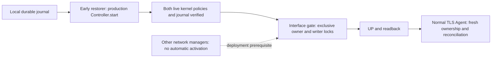
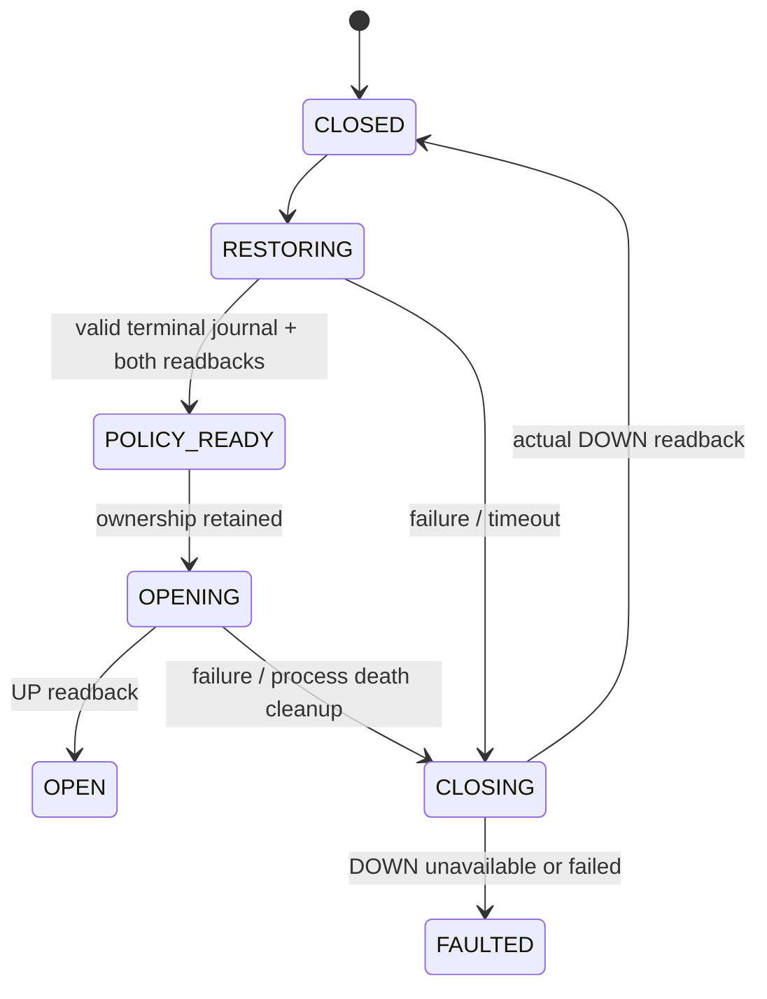

# Early policy loading and interface gate: design experiments

Historical design-exploration evidence, preceding the installed
[Boot Guard MVP](BOOT_GUARD.md). Its source fingerprint remains historical;
use the audit without `--current-source` to check its own frozen receipts.


This is a design exploration, **not an installed Boot Guard feature**. The default
`deploy/rulemoor.service` is unchanged. The experimental scripts are deliberately
under `tools/`; they are not wheel entry points or installation instructions.

## Outcome and evidence boundary

Four experiments run under actual systemd in a dedicated Colima Linux VM. The
fixture builds and installs the production wheel, compares installed module bytes
with its frozen source manifest, and uses the installed `Controller`, `Store`,
`NftBackend`, and Agent. The interface gate and its units are experimental
orchestration. The test owns one disposable namespace/veth pair and never gates
the VM's SSH/network interface. A second real systemd-networkd instance runs in
that namespace with private network configuration and runtime mounts.

[Machine-readable receipts](../reviews/boot/exploration.json) and the
[HTML report](../reviews/boot/report.html) retain observations and negative
controls. Prior deployment/platform reports retain their original source hashes;
these experiments do not retroactively extend their coverage.

| Exploration | Tested condition | Architecture consequence |
| --- | --- | --- |
| Failed startup | Corrupt real journal, rejected nft input, start timeout, IPv6-only kernel drift, rejected IPv6 batch | Convert DEGRADED into a nonzero prerequisite result; require both live family readbacks. Failure must not open the interface. |
| Interface authority | Manual networkd start/restart/profile reload, competing `ActivationPolicy=up`, stopping networkd, delayed and restarted installed Agent | Exclusive activation authority is a deployment precondition. `manual` is not a force-DOWN policy; stopping a manager is not closing an interface. |
| Crash during opening | SIGKILL before UP and after UP, post-UP exception, competing Controller, injected cleanup-command failure | Retain ownership through final validation and UP. Cleanup requires real DOWN readback; otherwise FAULTED, with an explicit manual recovery requirement. |
| Recovery and handoff | Production Controller admits a pending successor after gate ownership is released; orderly VM reboot retains pending journal before restoration; both baseline policies restored before UP; old receipt and same-boot namespace recreation | Receipts cannot authorize opening. Reconcile live state, retire writers and check fresh identity every time. A same-boot missing policy is not an invitation to guess or restore blindly. |

Two counterexamples are expected successful discoveries, not safety successes:

* `Requires=` plus `After=` still allows the consumer to run if its prerequisite
  is skipped by `ConditionPathExists=`. The fixture actually observes an UP
  interface. The candidate gate therefore has no skip condition; any future
  consumer must verify live state itself, rather than trusting dependency success.
* Another manager using `ActivationPolicy=up` opens the interface; stopping that
  networkd leaves it UP. `manual` prevents that manager from activating the link
  in the observed configurations, but does not reject privileged competing actors.

The direct `nft` syntax/batch faults replace the experimental gate's ExecStart
with a failing nft prerequisite. They test systemd dependency failure, **not**
`NftBackend.initialize/execute` failing during a production recovery write. Journal
corruption and IPv6 drift do exercise the installed Controller's diagnostic path.
The delay test uses the installed Agent entry point in an experimental unit, not
the unchanged production unit template as an early loader.

The cleanup failure is a **command-level injected exception**, not a kernel hang.
It deliberately leaves the interface UP and records FAULTED; fixture cleanup then
performs a separately observed manual DOWN. The post-UP SIGKILL case also proves
an actual UP interval exists before cleanup. The two kill points are explicit
holds before/after the link operation, not an exhaustive interruption of each
kernel instruction. The new receipts bind held PID/start ticks, namespace and
service InvocationID to the observed SIGKILL result. Owner and writer locks are
challenged separately; only the exact structured ownership rejection is accepted.
Neither case supports a zero-exposure claim. Normal closing changes interface state; it does not flush firewall rules.

## Revised proposed architecture



The restorer requires only local Python, local state and nftables. It must not
require TLS credentials, DNS, network mounts or the network it is protecting.
It reuses the production recovery path rather than a second rollback engine.
It treats `Controller.start()` returning DEGRADED as a failure, not as successful
initialization. An unknown kernel policy remains untouched for local inspection.

The prototype holds `agent.lock` continuously across recovery, then `writer.lock`
across the final journal/policy check and interface UP/readback. Production writer
retirement remains in `Controller.start()`. After the gate releases ownership,
the actual Agent must acquire it and reconcile again; a past receipt never
bypasses that check. This is a checked release/reacquisition, **not an atomic
process-to-process lock transfer**. An arbitrary root writer is outside the lock
protocol. The experiment does not add a new delayed-executor fault case; existing
[executor fencing evidence](DUAL_RECOVERY.md) remains separately scoped.

Receipts identify boot, namespace inode, ifindex, generation and policy digest.
They are diagnostic artifacts, not access credentials. The prototype ignores
old receipts and derives a new one from live state. Revalidation is checked against
the full fresh journal/policy/identity receipt. During namespace recreation the
old namespace is pinned open so its inode cannot be reused for the successor.
Missing tables also cause rejection in that case: it does not independently
prove rejection of a stale interface identity when live policy is otherwise valid. A production profile must
also define immutable interface identity, configuration digest and replacement
semantics before general deployment is supported.



This is a startup gate, not continuous protection monitoring. A normal Agent
restart must not automatically stop the gate or flap the interface. A later
committed policy generation invalidates old receipts for future openings, not an
already-open interface. Any explicit reopen requires a fresh live verification.
The experimental gate must not be deployed by copying its fixture units: these
units intentionally demonstrate unsafe consumers and failure injection.

## Retained run — 2026-10-21

The final frozen run `eb08f5581fec7bc0` passed all four exploration groups,
setup, handoff, post-boot verification and cleanup (nine recorded phases), plus
27 deliberately corrupted-report negative controls. Its source fingerprint is
`a300356be0c7e71f18aec8979cd95c9c53ef93bab388f7201bea6f10758f99a7`.
The environment was systemd 255, Linux 6.8.0-117-generic/aarch64, nftables 1.0.9
and Python 3.12.3. One orderly VM stop/start was performed. Both pre-restoration
and post-restoration boot identities are retained. All probe units/namespaces,
installed fixture credentials/state and uploaded sources were removed; the VM
root firewall digest was unchanged and the VM ended stopped.

The [native test receipt](../reviews/boot/native-unit.json) records **119 tests
passed on macOS, zero failures/errors/skips**, using the exact same executable
source manifest as the VM exploration. Eight tests challenge the new report
boundaries. This is not a claim that all 119 portable tests ran inside this VM
experiment. Earlier full Linux portable-suite results remain separately scoped.
During the initial exploration, the first restricted native invocation could not bind test sockets; it was rerun
with local test-socket permission and passed. That restriction is not counted as
a product defect or a passing run.

The host VM stop/start plus post-boot control/verification interval was
11.734 seconds. The post-boot experimental gate's own
recovery/verification/open interval was 46.924 ms.
These are one observation each, with different clock origins and scopes; they
are not bounds, pure kernel timings, throughput results or performance benefits.

[Independent review and corrections](BOOT_GUARD_REVIEW.md) describe the evidence
validation gaps fixed before retaining this run.

## Proposed first MVP acceptance criteria

The four experiments justify proceeding with a **single opt-in, static dual-stack
veth profile in an isolated Linux VM**, with the following requirements:

1. Fresh boot creates the controlled interface DOWN. A boot-scoped observer
   captures journal and both absent owned tables before restoration. Only a
   durable terminal state with exact paired policy readbacks permits UP.
2. Agent startup delay or TLS credential failure cannot block early restoration.
   Delay was tested here; TLS failure independent of the gate still needs an
   explicit integrated MVP case. Existing general deployment TLS-failure evidence
   is not substituted for that test.
3. Corrupt/unreadable journal, nft failure, timeout, unknown drift, either-family
   mismatch, skipped prerequisite or stale identity cannot authorize UP. The
   current experiment covers corrupt JSON, but not actual hung/failed storage I/O.
   Add a real recovery-write failure through the production backend; the direct
   nft prerequisite counterexamples are not a substitute.
4. One named manager owns activation. The installer rejects unsupported profiles,
   automatic competing managers, network-backed state and ambiguous identity.
   The experiment demonstrates the competition risk; it does not implement that
   installer or enumerate all other managers.
5. SIGKILL on both sides of UP and a cleanup failure produce observed CLOSED or
   FAULTED, never false success. Preserve existing policy; do not flush other tools'
   tables. Cleanup has bounded execution, but unavailable kernel execution is not
   a guaranteed close.
6. Hold both production ownership protocols at the final verification/UP boundary.
   Agent reacquisition rechecks journal/kernel. An integrated delayed-executor
   release during handoff must be added to the MVP; a held competing Controller
   alone does not prove every writer boundary.
7. Real orderly VM reboot separately covers pending/partially confirmed and
   committed states, with pre-restorer receipts and independent family readbacks.
   This exploration tested a pending transaction with **no** family confirmed.
   Earlier partial-confirmation reboot tests did not include this gate; the
   integrated partial and committed gate-boot cases remain MVP acceptance work.
8. Add data-plane observations from a separate peer, allow/deny canaries for each
   family, and a link-event monitor. Current evidence uses kernel readbacks and
   interface-state samples, not continuous packet observations or proof of no
   intermediate flap. API readiness, policy readiness and link readiness must be
   separate report fields.
9. Reproducible JSON/HTML must reject missing cases, nonzero/timeout stages,
   inconsistent paired policy/boot/generation, incomplete cleanup and false CLOSED.
   Require the exact ordered build/upload/reboot/cleanup stages, same killed
   process/invocation, fresh receipt identity, and installed site-packages origin.
   During execution the report must remain incomplete until cleanup and independent
   evidence checks finish; a supplied `passed=true` alone must never render green.
   Preserve failed-run records; do not promote edited old evidence to a new run.

## Reproduce and audit

Requires the existing pinned local toolchain, Python 3.12+, wheel build support,
and a dedicated **stopped** Colima VM with systemd, nftables and iproute2. The
runner obtains the existing profile lock, rejects leftover fixture paths, installs
only into the dedicated VM, performs one orderly stop/start, removes owned
units/state/namespaces, checks the VM root firewall digest and stops the VM.
It never changes the host network. Do not point it at a general-purpose VM.

```sh
.venv/bin/python -m tools.validate_boot \
  --colima-home /path/to/dedicated-colima-home \
  --output results/boot-exploration-fresh \
  --allow-vm-restarts
.venv/bin/python -m tools.boot_report results/boot-exploration-fresh --current-source
.venv/bin/python -m unittest discover -s tests -p 'test_boot_report.py'
```

The new output directory must be empty. Stage logs remain in ignored
`private-logs`; retained reports omit credentials, TLS challenges and home paths.
The verifier checks frozen provenance, the full ordered stage protocol and exact
HTML rendering. When `native-unit.json` is present the audit also binds its test
IDs/counts/outcomes to the same source; otherwise it explicitly reports VM-only.
It rejects a source-tree import path even if the module hashes match;
it is not a cryptographic attestation of an untrusted host. Boot-clock observations are
compared within one boot only. Host stop/start intervals include VM and control
work, and are not policy recovery latency or a benchmark. No RSS/performance
improvement is claimed by these experiments.

## Explicit exclusions

No physical NIC, NetworkManager, DHCP/SLAAC deployment, initramfs/firmware network,
whole-host early-boot fail-closed behavior, WAN reachability, arbitrary privileged
writer, kernel hang, hard power loss or disk-controller durability was tested.
No production Boot Guard is installed or promised. **Opening-zero-gap and sudden
power-loss recovery remain untested.**

## Primary design references

* [systemd network synchronization targets](https://systemd.io/NETWORK_ONLINE/):
  ordering targets are not interface ownership.
* [systemd 255 unit dependencies](https://www.freedesktop.org/software/systemd/man/255/systemd.unit.html#Requires=):
  requirement, ordering and skipped conditions differ.
* [systemd 255 ActivationPolicy](https://www.freedesktop.org/software/systemd/man/255/systemd.network.html#ActivationPolicy=):
  manual is different from forcing DOWN.
* [systemd 255 networkd lifecycle](https://www.freedesktop.org/software/systemd/man/255/systemd-networkd.service.html):
  daemon exit generally retains link configuration.
* [systemd 255 cleanup semantics](https://www.freedesktop.org/software/systemd/man/255/systemd.service.html#ExecStopPost=):
  startup failure cleanup needs ExecStopPost and explicit startup timeouts.
* [Upstream mandatory-pre-network discussion](https://github.com/systemd/systemd/issues/39364):
  design discussion supporting the failure-gate experiment, not a universal
  guarantee or a claim that every supported systemd release is defective.
