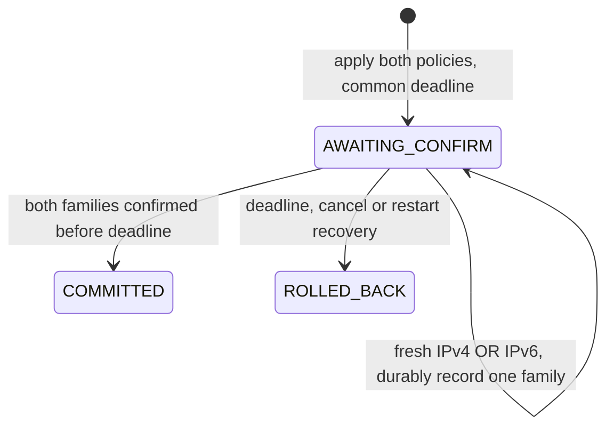

# Dual-stack minimum slice

This opt-in mode manages **two dedicated input tables, `ip rulemoor` and `ip6 rulemoor`, as one change**. It requires one fresh IPv4 TLS confirmation and one fresh IPv6 TLS confirmation before committing. A successful IPv4 connection alone cannot confirm IPv6 availability. This is an early single-node TCP ingress change controller, not a general IPv6 firewall or production availability guarantee.

## Fresh installation and policy

Existing IPv4 installations retain their schema, table and service behavior. There is no automatic or in-place migration. Both init and serve require `--dual-stack` for a fresh dual installation. Initialization refuses an existing journal or either preexisting owned table. Plan/apply cannot switch a running installation between legacy and dual modes. A wrong backend mode is refused during startup reconciliation; use the mode matching the reviewed installation and retain independent console access. Do not delete live rules/state to force adoption.

A dual policy has exactly `ipv4` and `ipv6`, each using the existing strict `default`/ordered TCP `rules` schema (at most 32 rules per family). See [baseline](../examples/dual-baseline.json) and [candidate](../examples/dual-candidate.json). Nested dual policies and unknown fields are rejected. Both table replacements are submitted through one `nft -f` batch. Readback includes both tables; a single missing table is drift, not complete absence that can be automatically recreated.

**ICMPv6 is always accepted before TCP rules in this minimum slice**, as is established/related traffic. This explicit choice preserves IPv6 control traffic rather than silently disabling neighbour discovery with a default-drop TCP policy. It also means Rulemoor does not enforce an ICMPv6 filtering policy: default drop does not override those earlier accepts. Echo, router advertisements and other ICMPv6 are not individually restricted by Rulemoor; other tools retain their own rules. The static-veth test observes neighbour discovery, not routed PMTU, SLAAC, RA hardening or comprehensive ICMPv6 security.

For a disposable fresh Linux environment, after provisioning private credentials and a certificate whose SAN covers both intended management IPs:

```sh
rulemoor-agent --state /var/lib/rulemoor init --dual-stack --policy examples/dual-baseline.json
rulemoor-agent --state /var/lib/rulemoor serve --dual-stack \
  --listen 192.0.2.2 --listen6 2001:db8:44::2 --port 18443 \
  --cert /etc/rulemoor/server.pem --key /etc/rulemoor/server.key \
  --token-file /etc/rulemoor/token
```

These are documentation addresses, not a host-configuration recipe. Provision actual interfaces, routing, certificates and console recovery for your environment. The sample production unit remains IPv4 by default. An explicitly reviewed dual deployment override changes its existing ExecStart arguments while retaining its state, credentials, sandbox and capability settings; the validation fixture uses the installed production entrypoint under such an override.

## Separate family confirmations, one deadline

```sh
rulemoor --family ipv4 --url https://192.0.2.2:18443 \
  --ca /secure/server-ca.pem --token-file /secure/operator-token \
  apply examples/dual-candidate.json --op dual-001 --generation 0 --window 30

# Use the generation returned by apply; this fresh-install example returns 1.
rulemoor --family ipv4 --url https://192.0.2.2:18443 \
  --ca /secure/server-ca.pem --token-file /secure/operator-token \
  confirm --op dual-001 --generation 1

rulemoor --family ipv6 --url 'https://[2001:db8:44::2]:18443' \
  --ca /secure/server-ca.pem --token-file /secure/operator-token \
  confirm --op dual-001 --generation 1
```

`--family` requires an IP-literal URL of the selected family; a hostname or mismatched literal is rejected before connecting, without DNS fallback. Normal TLS certificate verification remains enabled. The two server sockets are AF_INET and AF_INET6; the IPv6 listener explicitly sets IPV6_V6ONLY, excluding mapped IPv4 connections. Confirmation family is derived from the actual server socket, never an operator-supplied JSON/header field.



`confirmed_families` starts empty, then contains one family, then both only at COMMITTED. The first confirmation is durably recorded but leaves current/baseline unchanged and phase AWAITING_CONFIRM. Repeating it cannot complete the other family or extend the deadline. Either family can confirm first. Each confirmation checks operation/generation/digest/challenge, boot, deadline and post-apply connection freshness; accepted and queued old connections are rejected using family-specific `/proc/net/tcp` and `/proc/net/tcp6` snapshots. A malformed family receipt in the journal is not silently accepted.

Timeout/cancel restores the entire baseline through the normal fenced executor. Process restart with one confirmed family also restores the entire last committed baseline; it does not resume or promote the partial confirmation. New generations invalidate old operations. The shared journal's FULL-sync writes and existing ownership checks remain prerequisites; no independent timer runs while the service is stopped.

There are at most 16 active accepted connections per listener (32 across dual listeners), each with the existing five-second absolute lifetime. Both listeners share the serialized Controller. This is not a guarantee against continuous connection saturation or an assurance that every possible management route works.

## Preflight boundary

The existing optional management-path preflight and external-conflict evaluator remain **IPv4-only**. For a dual policy they inspect its IPv4 component and explicitly return `ipv6_preflight: not_implemented`, with reachability unverified. Do not interpret an IPv4 allowed/no-observed-conflict result as an IPv6 safety decision. This slice relies on explicit fresh IPv6 confirmation and overall rollback, not on unimplemented IPv6 semantic/topology diagnostics. Other tools' rules are never automatically modified.

[Agent-assisted review and evidence corrections](DUAL_REVIEW.md)

## Tested scope

Portable tests call the production policy compiler/reference, strict journal reader, Controller, IPv4/IPv6 TLS servers and CLI transport. They challenge partial receipts, persistence failures, legacy compatibility, mode mismatch, repeated IPv4 confirmation, family spoofing, old connections, deadline rollback and restart/reboot state contracts. These use a memory backend and synthetic proc records where stated; they are not kernel or hardware tests.

The separate isolated Linux VM runs the installed production systemd service over static IPv4/IPv6 veth peers in disposable namespaces. It checks refused legacy adoption; rejected-batch nonmutation; both initial TLS paths; old TLS and body spoof rejection; IPv4 partial confirmation while fresh IPv6 TCP is blocked; same-process whole-policy deadline rollback and fresh access after recovery; two-family commit after neighbour-cache flush; partial-confirmation SIGKILL recovery; stale requests during a distinct successor; and unchanged foreign tables in both families. Raw policies, process identities, clocks and results are retained in [JSON](../reviews/deployment/deployment.json) and [HTML](../reviews/deployment/report.html).

The two original orderly VM reboot cases exercise the **legacy IPv4 deployment**. The later [dual recovery extension](DUAL_RECOVERY.md) adds an actual partial-confirmation dual VM reboot and a forced orphan executor outside the unit cgroup. A committed-only dual VM reboot, routed PMTU, SLAAC/RA policy, WAN, arbitrary firewall compatibility, power loss, early-boot protection and uninterrupted existing connections remain untested. The orphan is held before its nft write and observed retired before successor admission; this is not coverage of every executor/kernel boundary. No speedup or production recovery-time bound is claimed. Dual confirmation times represent different state transitions (partial versus final commit); they must not be presented as an IPv4/IPv6 speed comparison. Agent RSS/VmHWM, service-cgroup memory and VM RAM have different scopes.


Retained executable source `c64749f0c951d14513ccc3e1cf18c0dc171c19e28310c259b6da4eb767a146ec`; native/container run `1ad17fa8d1bfd28b` (102 tests per platform, 29 production mutations); installed-service run `2d6bce1eafd34363` (14 groups, 51 report controls). Exact JSON/HTML and all cleanup checks are audited.
